# Original Project – Screenshot Evidence

The following screenshots document the original practical implementation of the Wazuh, Kali Linux, and Power BI cybersecurity risk analysis project.

## 1. Wazuh Monitoring Environment

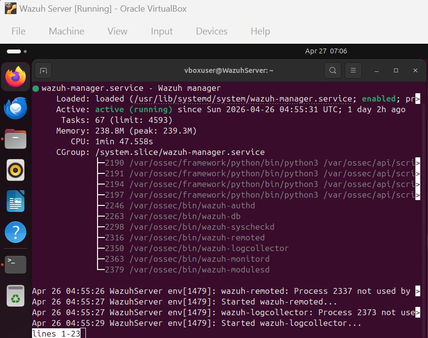

Evidence of Wazuh monitoring services.

## 2. Kali Linux Agent

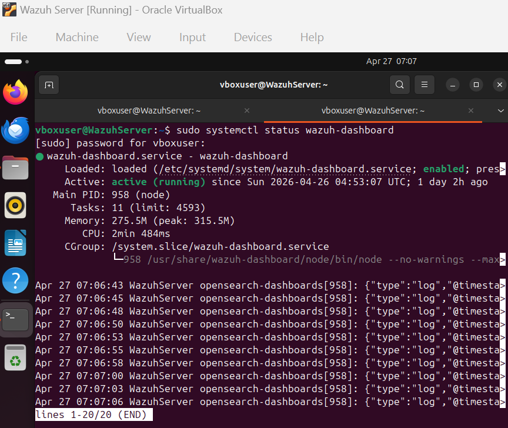

Evidence of the Kali Linux agent registered with Wazuh.

## 3. Security Event Discovery

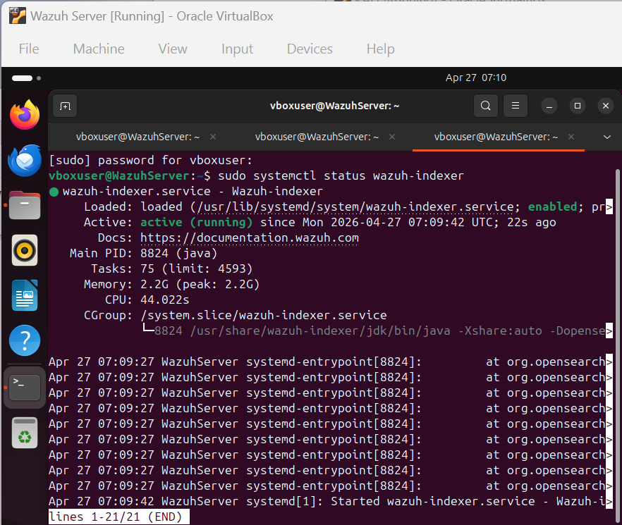

Security events viewed through Wazuh.

## 4. Security Events Dashboard

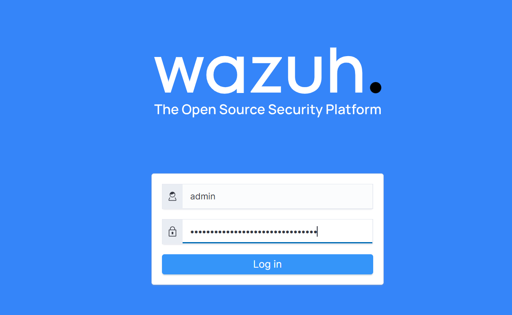

Overview of monitored security activity.

## 5. MITRE ATT&CK Detections

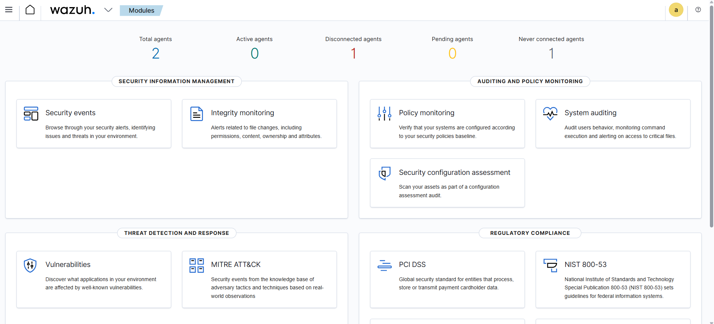

Threat detection information and associated techniques.

## 6. Port Monitoring

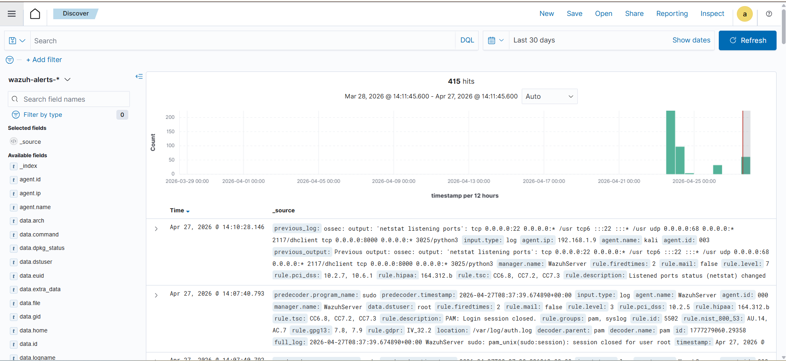

Port-status change alert observed in the environment.

## 7. Authentication and Privileged Activity

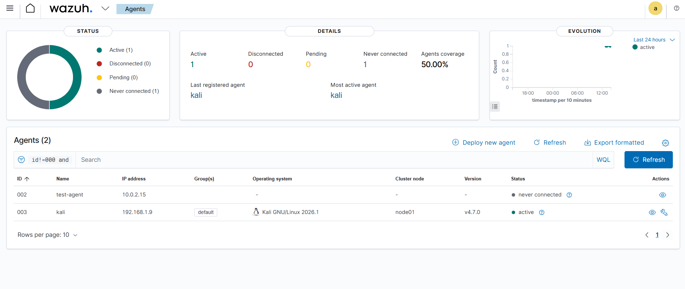

Authentication and sudo-related event evidence.

## 8. Power BI Dashboard

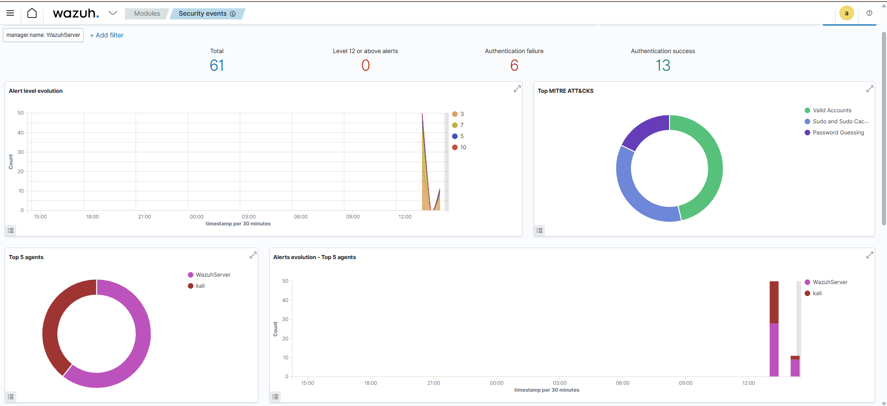

Power BI visualisation of cybersecurity monitoring information.

## 9–11. Additional Project Evidence

The remaining screenshots are preserved as additional records from the original project.

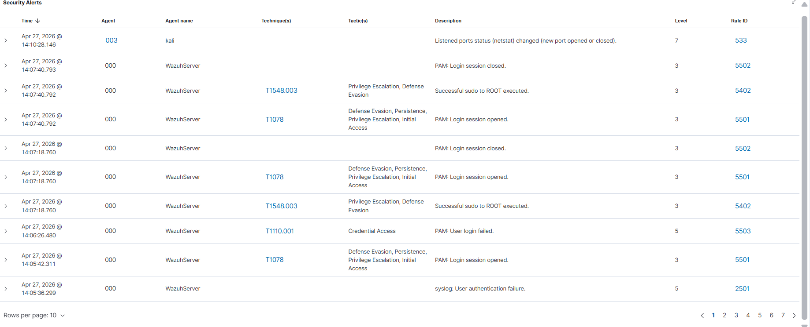

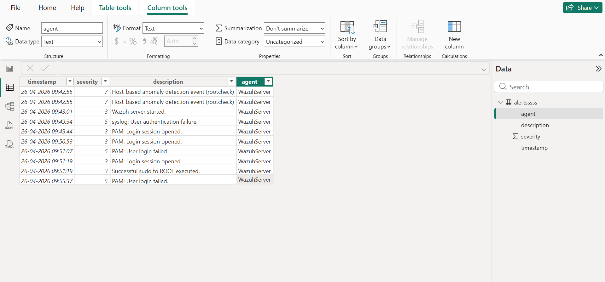

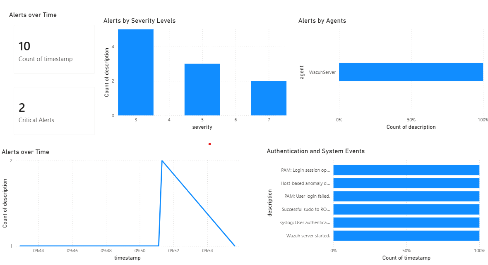

---

**Evidence note:** These are screenshots from the original practical project. They are presented as historical evidence and have not been represented as a currently running environment.
